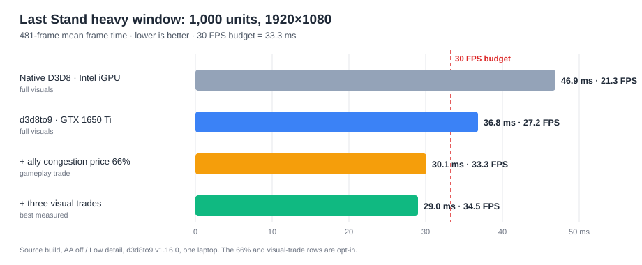

# Zero Hour Engine Optimization

EA has not endorsed and does not support this product.

Targeted C++ engine patches for **Command & Conquer: Generals Zero Hour**, based on the
[TheSuperHackers/GeneralsGameCode](https://github.com/TheSuperHackers/GeneralsGameCode) fork of
EA's released engine source. The repository contains the patched engine source, a reversible
Windows singleplayer patcher, replay and benchmark tooling, and the evidence behind each result.

This project was developed with assistance from Codex and OpenCode.
The [`.opencode` session notes](.opencode/continuity.md) document development decisions,
verification results, and remaining work.

## Quick start

**Download.** [Windows patcher ZIP](https://github.com/Shiromama/Command-and-Conquer-Generals-Optimization/releases/download/v0.1.0-alpha.2/zh-patcher-0.1.0-alpha.2.zip)
· [Release notes and checksum](https://github.com/Shiromama/Command-and-Conquer-Generals-Optimization/releases/tag/v0.1.0-alpha.2).
To build from source, see the [engine build guide](engine/README.md).

Once you have the patcher ZIP:

1. Close Zero Hour and any mod launcher. Make a writable copy of your compatible
   Zero Hour installation.
2. Extract the entire patcher ZIP into a separate folder. Open `Patcher.cmd`,
   select your game copy, and choose **Install**.
3. Open `Generals.exe` from the patched copy and start a singleplayer skirmish.
4. To restore the original files, close the game, open `Patcher.cmd`, select the
   same copy, and choose **Uninstall**.

> The published package is the verified installer track. It ships the **33% ally-cost pathfinding
> profile**. The 66% benchmark configuration and the three visual trades remain source/playtest
> options; the 29.0 ms result below is not the package default. The package uses system Direct3D 8
> and does not install `d3d8to9`.

## Benchmark highlights

### Above 30 FPS in the 1,000-unit Last Stand window

[VERIFIED] A 481-frame heavy window (frames 16,919-17,399 of a 17,402-frame replay, 1,000 units,
1920×1080) now runs at **30.1 ms / 33.3 FPS** with the opt-in 66% ally-congestion price, and
**29.0 ms / 34.5 FPS** when the three visual trades are added. The same build measured
**36.8 ms / 27.2 FPS** with full visuals on the GTX 1650 Ti, and **46.9 ms / 21.3 FPS** on the
native Direct3D 8 / Intel path in the matched A/B pair.

**CRC** (cyclic redundancy check) is a short fingerprint the engine computes over the game state each
frame. Matching CRCs and command streams mean the run reproduced the reference simulation exactly; a
different CRC means the configuration changed the battle.

| Configuration | Mean | FPS | Logic | Path | Draw | Replay |
|---|---:|---:|---:|---:|---:|---|
| Native D3D8 (Intel iGPU), full visuals | 46.9 ms | 21.3 | 32.9 ms | — | 12.6 ms | reference CRC |
| `d3d8to9` (GTX 1650 Ti), full visuals | 36.8 ms | 27.2 | 31.0 ms | 14.7 ms | 4.5 ms | reference CRC |
| + ally congestion price 66% | 30.1 ms | 33.3 | 25.5 ms | 9.7 ms | — | completes; different CRC |
| + ally 66% and visual trades | **29.0 ms** | **34.5** | 25.4 ms | 9.8 ms | 2.3 ms | best measured; different CRC |

The heavy-window gate is a mean frame time; FPS is `1000 / mean`. `Path` is the pathfinding time
inside logic. The reference replay is CRC `04C62655` with 983 commands; the 66% configuration is
deterministic at CRC `695F3403` with 523 commands and still reaches frame 17,402. The three visual
trades skip occluded-object rendering, volumetric shadows, and particle rendering. Both profiles
are opt-in.

These are controlled runs on one laptop, not a retail-vs-patched comparison. All use AA off and Low
detail (the project's performance profile), and the fixed-work calibration varies up to 1.43×
between sessions, so small deltas are noise. The 29.0 ms run was 2.3% faster-calibrated than the
36.8 ms baseline; at matched calibration the gain is about 19%.
[Full result and limitations](docs/research/2026-11-25-last-stand-congestion-price.md) ·
[Hardware](docs/environment.md#5-host-hardware-target-machine)

The **downloadable alpha ships the 33% profile**, not the 66% benchmark row above. At 33% the
benchmark replay resolves around frame 8,400, before the heavy window, so the package does not
claim the 29.0 ms / 34.5 FPS result. The 33% value is the user-selected feel profile; the 66% value
and the visual trades remain source/playtest configurations.

### Why ShockWave and Last Stand?

[VERIFIED] ShockWave is a **data-only mod on the stock Zero Hour 1.04 engine**: its
`game.dat`/`Generals.exe` hash matches vanilla, so it does not add a separate engine. The
benchmark runs that mod data through the rebuilt SAGE engine, so engine changes can be attributed
to our build rather than a mod fork. The mod adds a much larger rules/scenario surface than stock
(1.29× objects, 2.05× weapons, 2.81× FX lists) and provides the dense 1,000-unit and nuke
scenarios. The original slowdown report was a ShockWave 1.201 late-game skirmish, and compatible
mod data is a project goal, so this is the workload that matters.
[ShockWave inventory](docs/game-inventory-shockwave.md) ·
[Stock-vs-mod design](docs/research/2026-11-20-stock-vs-mod-design.md) ·
[Nuke benchmark](docs/experiments/EXP-008-shockwave-nuke-performance.md) ·
[ShockWave on ModDB](https://www.moddb.com/mods/cc-shockwave)

[VERIFIED] The Last Stand benchmark uses a community **350×200, 1-vs-7 survival map** with
narrow lanes and continuous scripted group orders, plus a 29:23 replay (1 human vs 7 Hard
armies, 52,902 logic frames). It reproduces the user-reported slowdown: pathfinding was
70.5% of the 300-frame window, and frames 16,919–17,399 are the 481-frame heavy window. It is
a deliberate worst case, not an average frame rate.
[Last Stand attribution](docs/research/2026-11-19-last-stand-slowdown.md) ·
[Replay/map repair](docs/issues/ISSUE-0107-stress-replay-map-path.md) ·
[Last Stand on C&C Labs](https://www.cnclabs.com/downloads/details/2668/)

| Fixture | What it is | Credit / provenance | Redistributed? |
|---|---|---|---|
| ShockWave 1.201 | Data-only community mod on Zero Hour 1.04 | [SWR Productions](https://www.moddb.com/mods/cc-shockwave) | No |
| Last Stand map | 350×200, 1-vs-7 community survival map | **KhianVictory** (Khian Victory D. Calderon), per the map's `Map.str` and [C&C Labs](https://www.cnclabs.com/downloads/details/2668/) | No |
| Last Stand replay | 52,902-frame, 1 human vs 7 Hard | User-recorded; map checksum `B44EACE8`, map SHA-256 `20BAD834…ED41` | No |

**Benchmark-content disclaimer.** Command & Conquer, Generals, Zero Hour, ShockWave and the
Last Stand map are the property of their respective owners. This is an unofficial fan project
and is not affiliated with or endorsed by EA, SWR Productions, or the map author. The repository
and patcher package do not include the mod, map, replay, or extracted game assets; obtain them
from their authors and follow their terms. These numbers are specific to ShockWave 1.201, Zero
Hour 1.04, this map/replay and the stated settings; other versions, maps, and hardware will
differ. The replay was recorded on a patched engine and standard playback still diverges in
places ([ISSUE-0108](docs/issues/ISSUE-0108-last-stand-replay-sync.md)); mod compatibility is
not certified.

### What moved the needle

- **Route the game to the discrete GPU.** [VERIFIED] Native Direct3D 8 exposes only the Intel UHD
  adapter on this hybrid laptop. The optional `d3d8to9` v1.16.0 wrapper routes the same build to
  the GTX 1650 Ti: heavy 46.9 → 36.8 ms, draw 12.6 → 4.5 ms, exact reference replay. The wrapper is
  not installed by the patcher. [GPU path](docs/experiments/EXP-006-d3d8to9-wrapper.md)
- **Charge less for ally congestion.** [VERIFIED] `ZH_ALLY_COST_PCT=66` cuts pathfinding from
  14.7 to 9.7 ms/frame and heavy from 36.8 to 30.1 ms, deterministically. It changes group routing
  and the battle, so it stays an opt-in gameplay trade.
  [Congestion-price note](docs/research/2026-11-25-last-stand-congestion-price.md)
- **Skip three visual passes.** [VERIFIED] `ZH_SKIP_OCCLUDED`, `ZH_SKIP_VOLUMETRIC`, and
  `ZH_SKIP_PARTICLES` cut draw from 4.5 to 2.3 ms and combine with the congestion price for the
  29.0 ms result. Logic is unchanged by these switches; they skip occluded-object rendering,
  volumetric shadows, and particle rendering, and are a visual trade.
- **Earlier source work.** A 512-slot group route cache, a width-6 path kernel, and a per-search
  unit memo made the 1,000-unit replay affordable before the congestion price. These are in the
  source tree and in the measured baseline.

### Where the time goes

| 36.8 ms baseline | ms/frame | Share |
|---|---:|---:|
| Logic (simulation) | 31.0 | 84% |
| — pathfinding | 14.7 | 40% |
| Client (input, UI, draw submission) | 5.3 | 14% |
| — draw | 4.5 | 12% |

The path budget is about 20 ordinary, closest, and attack searches per frame at 500-700 µs each,
with 0% exact repeats within 20 frames. The group kernel is only 0.51 ms/frame (3.4% of path time),
so caching or prefetching group searches cannot close the gap. The heavy mean is also a tail
problem: 49 of 481 frames carry 22-23% of the time, and the worst frames contain a single 49-50 ms
search.

### Measured and rejected

These were real candidates that did not survive controlled measurement. They are listed so the
same work is not repeated.

| Change | Measured result | Why it was not kept |
|---|---|---|
| Group route cache TTL 24 | 42.9 ms vs 36.8 | 21-frame-old routes diverge; the 292 misses are necessary work |
| Search cap 10,000 | 45.0 ms; 2,331 commands | Capped searches are re-issued; retry storm |
| Admissible heuristic | 56.6 ms; +62% expansions | The retail overestimate is load-bearing |
| Render-thread overlap | 37.2 ms vs 39.2 control | Still above the 36.8 fast-regime baseline; draw is CPU-bound and contends with logic |
| Shadow-map renderer | 14% slower median | The stencil path is faster |
| Triple buffering | +0.08 ms | No measurable gain |

## Graphics settings benchmark

[VERIFIED] In controlled 1920×1080 benchmarks on one laptop, switching from **8× anti-aliasing and
High detail** to **AA off and Low detail** reduced frame times in both test scenes. Each comparison
used the same rebuilt engine with the render cap disabled on both sides. Stock used system
Direct3D 8. ShockWave used d3d8to9 on the GTX 1650 Ti.
[Setup and full results](docs/experiments/EXP-013-original-vs-optimized.md#5-uncapped-re-run-t-058--the-definitive-numbers) ·
[Test hardware](docs/environment.md)

| Test scene | Median frame time | p95 frame time |
|---|---:|---:|
| Stock Zero Hour, 1,000 tanks (3 alternating pairs) | 21.86 → 6.47 ms | 27.12 → 8.26 ms |
| ShockWave, five 1,000-unit spawn and nuke cycles (2 alternating pairs) | 8.62 → 4.33 ms | 177.37 → 61.59 ms |

Lower is better. The p95 is the frame time that 95% of frames finish within. These figures describe
the settings change on the benchmark build; they are not the code-change results above. Real
late-game replay validation is still open.
[Replay validation blocker](docs/issues/ISSUE-0010-heavy-replay-unavailable.md)

## What changed

- **Alt+Tab crash workaround.** [VERIFIED] During repeated switches out of exclusive fullscreen,
  the retail game crashed when its renderer tried to use a missing texture. [INFERRED] A graphics
  reset during the switch likely left the texture unavailable. To avoid that fullscreen reset, the
  patched game opens windowed by default, and `zh-patcher.exe play` opens it borderless.
  [VERIFIED] The rebuilt engine with d3d8to9 completed 120 focus-switch cycles in a borderless
  1920×1080 ShockWave skirmish without crashing.
  [Crash analysis and stress test](docs/issues/ISSUE-0011-shockwave-alt-tab-null-texture-crash.md) ·
  [Launch modes](patcher/README.md#changes-in-this-build)
- [VERIFIED] Engine work includes faster debris collision candidate filtering, a corrected guard
  range for human-owned stock units in singleplayer, and separate skirmish simulation speed and
  rendering FPS controls. The source tree also contains the group route cache, width-6 kernel,
  per-search memo, and the opt-in congestion-price and visual-trade switches. The `0.1.0-alpha.2`
  package ships the 33% ally-cost default; 66% and the visual trades remain source/playtest options.
  [Debris validation](docs/experiments/EXP-011-broadphase-correctness.md) ·
  [Guard range experiment](docs/experiments/EXP-030-guard-range-runtime.md) ·
  [Pathfinding work](docs/research/2026-11-25-last-stand-congestion-price.md)
- [VERIFIED] Stock Zero Hour and ShockWave reached their main menus in native 1920×1080 smoke
  tests. The published pre-release passed separate install, verify, and uninstall checks on
  disposable copies, restoring all 1,914 stock and 288 ShockWave original files.
  [Launch smoke tests](docs/log.md#2026-11-18---t-080-alpha-candidate-verified-t-081-added-before-finalization) ·
  [Pre-release verification](docs/log.md#2026-11-18---t-102-publish-the-windows-singleplayer-pre-release)

## Compatibility

This is a **singleplayer alpha**. Use a writable copy of your own compatible Windows installation
of Zero Hour. The [patcher guide](patcher/README.md) lists the recognized game files and supported
runtime configurations. Multiplayer, existing saves, replays, and compatibility with individual
community mods still need validation. The 33% ally-cost profile is baked into the published package;
the 66% benchmark configuration and visual-trade switches are source experiments, not package
options.

## Source and build

- [Engine build instructions](engine/README.md) and [patch layout](engine/patches/README.md)
- [Patcher usage and recovery](patcher/README.md)
- [Performance experiments](docs/experiments/EXP-013-original-vs-optimized.md) and
  [documentation index](docs/INDEX.md)
- [Current project status](docs/state.json) and [contributor instructions](AGENTS.md)
- [Licenses and upstream attribution](LICENSE.md)

Verify the documentation with `python tools/check_docs.py`.
